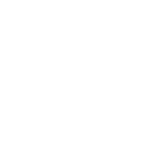
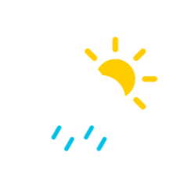
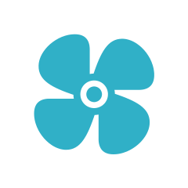
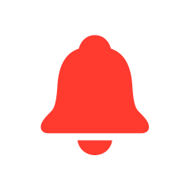

# SymbolReel

Export SF Symbols animations as video, including transparent ProRes 4444.

SF Symbols can preview every symbol effect but can't save one as a video. SymbolReel is a small
macOS command-line tool (and Swift library) that renders any SF Symbol with any effect, including
Draw On and Draw Off, to ProRes 4444 with alpha, HEVC with alpha, H.264 MOV/MP4, GIF or PNG frames.

<p>
  
  
  
  
  
  
</p>

```sh
symbolreel signature -e draw-on -f prores,mp4 --color "#007AFF"
```

## Features

- **Every system effect**: bounce, pulse, variable color, scale, wiggle, rotate, breathe, appear,
  disappear, draw on, draw off and replace (including Magic Replace), with all their options.
- **Transparent video**: ProRes 4444 and HEVC with alpha, ready for Final Cut Pro, Motion,
  After Effects, Premiere, DaVinci Resolve and Keynote.
- **Frame-accurate and reproducible**: frames are rendered at exact timestamps instead of being
  screen-recorded, so output is smooth at any frame rate and resolution (including 4K and
  120 fps), and the same command always produces identical frames.
- **Real system rendering**: animations come from SwiftUI's own symbol effects, so they look the
  same as in the SF Symbols app and in your apps, including Magic Replace.
- **Batch friendly**: render several symbols, effects and formats in one command.

## Requirements

- macOS 15 or later (Draw On and Draw Off need macOS 26 or later)
- Xcode 26 or later to build

## Installation

```sh
git clone https://github.com/npwitk/SymbolReel.git
cd SymbolReel
make install            # builds a release binary and copies it to /usr/local/bin
```

Or run it in place with `swift run symbolreel …`.

## Usage

```sh
# Transparent ProRes 4444 (the default format) in the current folder
symbolreel wifi -e variable-color.iterative

# Several formats at once
symbolreel signature -e draw-on -f prores,hevc-alpha,mp4

# Batch: every symbol × every effect, into a folder
symbolreel bell.fill heart.fill star.fill -e bounce -e wiggle.left -o exports

# Replace one symbol with another
symbolreel bell -e replace.magic --to bell.slash

# Repeat, slow down and hold the end
symbolreel heart.fill -e bounce --repeat 3 --repeat-delay 0.4 --speed 0.75 --tail 1

# Endless effects need a length
symbolreel wifi -e variable-color.iterative.reversing --repeat forever --duration 4

# Styling: rendering mode, colors, weight and a 1080p canvas with a background
symbolreel person.crop.circle.badge.plus -e bounce.by-layer \
  --rendering palette --color "#FF2D55,#007AFF" --weight semibold \
  --size 1920x1080 --background "#F2F2F7" -f mp4

# Write to an exact file path (one symbol, one effect, one format)
symbolreel signature -e draw-off -f mov -o ~/Desktop/signature.mov
```

Run `symbolreel effects` to list effects and their modifiers, `symbolreel formats` to list
formats, and `symbolreel --help` for every option.

### Effects

Write an effect as its name followed by dot-separated modifiers, like `bounce.down.by-layer`.
Names are case-insensitive, and `variable-color`, `variableColor` and `variable_color` all work.

| Effect | Modifiers | macOS |
| --- | --- | --- |
| `bounce` | `up`, `down`, `by-layer`, `whole-symbol` | 14 |
| `pulse` | `by-layer`, `whole-symbol` | 14 |
| `variable-color` | `iterative`, `cumulative`, `reversing`, `non-reversing`, `hide-inactive-layers`, `dim-inactive-layers` | 14 |
| `scale` | `up`, `down`, `by-layer`, `whole-symbol` | 14 |
| `wiggle` | `up`, `down`, `left`, `right`, `forward`, `backward`, `clockwise`, `counter-clockwise`, `by-layer`, `whole-symbol` | 15 |
| `rotate` | `clockwise`, `counter-clockwise`, `by-layer`, `whole-symbol` | 15 |
| `breathe` | `pulse`, `plain`, `by-layer`, `whole-symbol` | 15 |
| `appear` / `disappear` | `up`, `down`, `by-layer`, `whole-symbol` | 14 |
| `draw-on` | `by-layer`, `whole-symbol`, `individually` | 26 |
| `draw-off` | `by-layer`, `whole-symbol`, `individually`, `reversed`, `non-reversed` | 26 |
| `replace` (needs `--to`) | `down-up`, `up-up`, `off-up`, `magic`, `by-layer`, `whole-symbol` | 14 |

Draw On and Draw Off only work on symbols that support drawing, such as `signature`,
`scribble.variable` and `checkmark`. Check the **Draw** column in the SF Symbols app.

### Formats

| Format | Output | Alpha |
| --- | --- | --- |
| `prores` | ProRes 4444 `.mov`, for editing | ✅ |
| `hevc-alpha` | HEVC `.mov` with alpha, small and plays in Safari and Keynote | ✅ |
| `mov` | H.264 `.mov` | — |
| `mp4` | H.264 `.mp4`, plays everywhere | — |
| `hevc` | HEVC `.mp4` | — |
| `gif` | Looping GIF (capped at 50 fps) | — |
| `png` | Folder of numbered PNG frames | ✅ |

Formats without alpha use `--background`, or white if it isn't set.

### Options

| Option | Default | Description |
| --- | --- | --- |
| `-e, --effect` | `bounce` | Effect to render. Repeat for several. |
| `--to` | | Target symbol for `replace`. |
| `-f, --format` | `prores` | Comma-separated formats. Repeat or combine. |
| `-o, --output` | `.` | Output folder, or a file path for a single output. |
| `--rendering` | `monochrome` | `monochrome`, `hierarchical`, `palette` or `multicolor`. |
| `-c, --color` | `black` | Hex (`#007AFF`, `#007AFF80`) or a name (`blue`, `orange`, …). Comma-separate for palette mode. |
| `--weight` | `regular` | `ultralight` … `black`. |
| `--scale` | `large` | `small`, `medium` or `large`. |
| `--variable-value` | | 0–1 for symbols with variable rendering. |
| `--size` | `512` | Canvas in pixels: `512` or `1920x1080`. |
| `--padding` | `0.2` | Space around the symbol as a fraction of the shorter side. |
| `--background` | transparent | Background color. |
| `--fps` | `60` | Frame rate (1–240). |
| `--duration` | automatic | Effect length in seconds. Defaults to when the effect settles (3 s for `--repeat forever`). |
| `--lead-in` | `0.25` | Seconds to hold the resting symbol first. |
| `--tail` | `0.25` | Seconds to hold the last frame. |
| `--repeat` | `1` | Play count, or `forever`. |
| `--repeat-delay` | | Seconds between repetitions. |
| `--speed` | `1` | Playback speed multiplier. |

Symbols are scaled so their drawn shape fills the canvas inside the padding. Effects like bounce
and wiggle move beyond the resting shape, so lower `--padding` with care.

## Using the library

`SymbolReelKit` exposes the renderer for your own tools and apps:

```swift
import SymbolReelKit

let request = RenderRequest(
    symbolName: "signature",
    effect: try SymbolEffectSpec(parsing: "draw-on"),
    appearance: SymbolAppearance(colors: [RGBAColor(string: "#007AFF")!]),
    canvas: Canvas(width: 1080, height: 1080),
    timing: Timing(framesPerSecond: 60)
)

try await MainActor.run {
    try SymbolReel.render(request, to: [
        OutputTarget(format: .prores, url: URL(filePath: "signature.mov")),
        OutputTarget(format: .mp4, url: URL(filePath: "signature.mp4")),
    ])
}
```

Rendering uses SwiftUI and AppKit, so it runs on the main actor.

## How it works

1. A SwiftUI `Image` in an offscreen `NSHostingView` shows the symbol and applies the effect with
   the standard modifiers: `symbolEffect(_:options:value:)` for effects that play once,
   `symbolEffect(_:options:isActive:)` for endless ones, `.transition(.symbolEffect(…))` for
   appear, disappear and the draw effects, and `contentTransition(.symbolEffect(…))` for replace.
2. SymbolReel advances SwiftUI's animation clock by exactly one frame at a time with
   `NSHostingView._renderForTest(interval:)`, the hook SwiftUI uses in its own performance tests.
   That makes output independent of how fast the Mac renders, and identical from run to run.
3. Each frame is drawn with `CALayer.render(in:)` into a bitmap with premultiplied alpha, then
   encoded with AVFoundation (ProRes and HEVC alpha are tagged as premultiplied) or ImageIO.
4. Without `--duration`, an effect is considered finished once the picture stops changing for half
   a second. Those still frames are trimmed, so `--tail` alone controls how long the end is held.

`_renderForTest(interval:)` is public but underscored, meaning Apple doesn't promise it will stay
stable. It's the only such API SymbolReel uses.

Rendering through SwiftUI matters for content transitions. `NSImageView` lays out `bell` and
`bell.slash` by their full image bounds, so the bell jumps and leaves a ghost image during a Magic
Replace. SwiftUI keeps symbols on a shared baseline, like the SF Symbols app.

## Limitations

- Only system symbols are supported for now. Custom symbols from an `.svg` template aren't yet.
- Draw On and Draw Off require macOS 26, and only work on symbols that include draw data.
- GIF has no partial transparency, so GIFs are always drawn on a solid background.

## Using exported symbols

SF Symbols are licensed by Apple. Before using exported animations, read the license in the SF
Symbols app and Apple's
[Human Interface Guidelines for SF Symbols](https://developer.apple.com/design/human-interface-guidelines/sf-symbols).
In particular, symbols may not be used in app icons, logos or other trademark-related uses, and some
symbols represent Apple products and services and come with extra restrictions.

## Contributing

Issues and pull requests are welcome. Run `swift test` before sending a change, and render a few
effects with `swift run symbolreel …` to check the output.

## License

SymbolReel is available under the MIT license. See [LICENSE](LICENSE). This license covers
SymbolReel's source code only, not SF Symbols or anything rendered from them.
